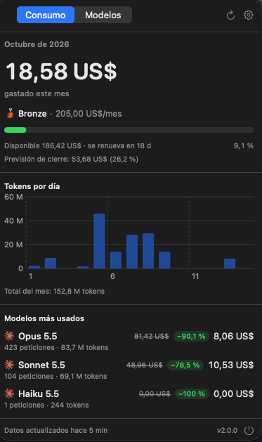
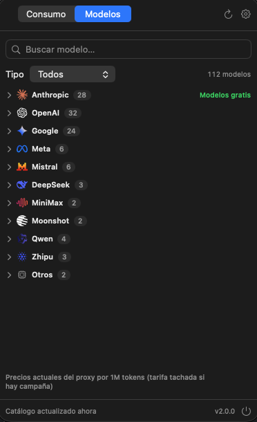

<p align="center">
  
</p>

<h1 align="center">Claude Usage Tracker</h1>

<p align="center">
  Your MasOrange AI spend, budget and available models in the macOS menu bar —<br/>
  the same data as <a href="https://ai-platform.cloud.masorange.es">AI Platform</a>, one click away.
</p>

<p align="center">
  <a href="https://github.com/masorange/ClaudeUsageTracker/releases/latest"></a>
  
  
  
</p>

<p align="center">
  
  &nbsp;&nbsp;
  
</p>

---

## Contents

- [Install or update](#-install-or-update)
- [Features](#-features)
- [Getting started](#-getting-started)
- [How it works](#-how-it-works)
- [Troubleshooting](#-troubleshooting)
- [Development](#-development)
- [License](#-license)

## 📦 Install or update

```bash
curl -fsSL https://raw.githubusercontent.com/masorange/homebrew-claudeusagetracker/main/install.sh | bash
```

One command for everything: it installs the app with Homebrew, updates it if you already have it, cleans up
old taps (`masmovil/…`, `SergioBanuls/…`) and opens the app. Your settings and sign-in are kept.
Run it again any time to update.

<details>
<summary>Prefer plain Homebrew commands or the DMG?</summary>

```bash
# Install
brew install --cask masorange/claudeusagetracker/claudeusagetracker
open -a ClaudeUsageTracker

# Update
brew update && brew upgrade --cask masorange/claudeusagetracker/claudeusagetracker

# Uninstall (add --zap to also remove settings, cache and sign-in data)
brew uninstall --cask claudeusagetracker
```

Or download the DMG from the [latest release](https://github.com/masorange/ClaudeUsageTracker/releases/latest).
Step-by-step guide, building from source and more: [INSTALL.md](INSTALL.md).

</details>

**Requirements:** macOS 13 (Ventura) or later, a MasOrange corporate account and, for the Models tab, your
LiteLLM key.

## ✨ Features

### 💰 Usage tab

| | |
|---|---|
| **Month-to-date spend** | Also shown in the menu bar: spend, spend + %, % of budget or icon only. |
| **Tier and budget** | Iron / Bronze / Silver / Gold with a progress bar (green < 75 %, orange 75–90 %, red ≥ 90 %), available amount, days until it renews and month-end forecast. |
| **Tokens per day** | Chart of the current month; hover a bar to see that day's tokens and spend. |
| **Most used models** | Cost of each model this month. Campaign discounts show the list price struck through, e.g. ~~81,42 US$~~ `−90,1 %` **8,06 US$**. |

### 🧠 Models tab

| | |
|---|---|
| **Every model you can call** | Claude, GPT, Gemini, Llama, Mistral, DeepSeek, Qwen… read from your LiteLLM key. |
| **Grouped by provider** | Collapsible sections with logos, newest version first; the header flags providers with free models. |
| **Current prices** | Context window and the price the proxy charges today per 1M tokens (input, output, cache). |
| **Live campaigns** | Read from the proxy's own pricing, so they are always current: list price struck through and a `Gratis` or `−50 %` tag. |
| **Search and copy** | Search by name, filter by type (Chat / Embeddings / Image / Other) and copy the exact model id. |

### ⚙️ And also

- Corporate **SSO sign-in once**; the session renews silently in the background.
- Spanish / English, USD / EUR, auto-refresh every 5–60 min, open at login and update notifications.

> Only the **LiteLLM** provider is shown — it is the one that consumes your budget. Usage covered by a
> Claude Enterprise seat is not billed and is not included.

## 🚀 Getting started

1. Click the **💰** icon in the menu bar (it shows `💰 ⚠︎` until you sign in).
2. Press **Sign in** and log in with your **corporate account (SSO)**. The window closes by itself and your
   data appears.
3. Open the **Models** tab. The app detects your LiteLLM key (the one Claude Code uses as
   `ANTHROPIC_AUTH_TOKEN`) from your Claude Code `settings.json` or a literal `export` in your shell profile.
   If it can't find it, paste it once in the tab.

You won't be asked to sign in again while your corporate Google session is valid. After an app update macOS
may ask once to let the new version read the LiteLLM key from the Keychain — choose **Always Allow**.

Settings (⚙︎ in the popover): menu bar text, language, currency, refresh interval, open at login, LiteLLM key
and sign out.

## 🔎 How it works

| Data | Source | Auth |
|---|---|---|
| Spend, tier, budget, tokens, models used | AI Platform read-only personal endpoints (`/api/v1/me`, `/me/month-glance`, `/spend/daily`, `/spend/by-model`) — exactly what the web calls | Your SSO session |
| Available models | LiteLLM proxy `/v1/models` | Your LiteLLM key |
| Prices and campaigns | LiteLLM proxy public cost map | None |

- **Same numbers as the web**, including its ~1 hour delay; the footer shows when the data was last updated.
- **Campaign prices are real:** the cost map's per-deployment entries carry the price actually charged
  (`claude-X` → campaign deployment, `claude-X-vertex` → list price), so when a campaign starts or ends the app
  shows it on the next refresh.
- **Privacy:** the SSO session lives only in the app's WebKit storage and the LiteLLM key in the macOS
  Keychain. They are only sent to `ai-platform.cloud.masorange.es` and `llm.tools.cloud.masorange.es`.

<details>
<summary>Why 2.0 is a rewrite</summary>

LiteLLM keys can no longer read spend (`/key/info` and `/user/daily/activity` return 403) and the Looker
dashboard was retired, so 1.x stopped showing correct numbers. 2.0 replaces those integrations, and the local
log estimation, with AI Platform.

</details>

## 🧰 Troubleshooting

| Problem | Fix |
|---|---|
| `💰 ⚠︎` in the menu bar | Your corporate session expired: open the popover and press **Sign in**. |
| `Cask claudeusagetracker exists in multiple taps` | You still have an old tap: run the [install command](#-install-or-update) again. |
| `"ClaudeUsageTracker" is damaged and can't be opened` | `xattr -cr /Applications/ClaudeUsageTracker.app` and open it again. |
| "AI Platform changed its data format" | The web API changed: update the app with the install command. |
| Numbers differ from the web | Server data refreshes roughly every hour: press ⟳ and compare the "Data updated" time in the footer. |
| Models tab asks for the key on every update | Choose **Always Allow** in the Keychain prompt. |

Logs: `log show --predicate 'subsystem == "com.claudeusage.tracker"' --last 1h`

## 🔨 Development

```bash
swift test                   # unit tests (UsageCore)
./build.sh                   # builds ClaudeUsageTracker.app (universal arm64 + x86_64)
open ClaudeUsageTracker.app
./create_release.sh 2.0.0    # app + DMG + SHA-256 in release/
```

```
Sources/
  UsageCore/            # UI-free: API clients, models, aggregation, pricing catalog, caches
  ClaudeUsageTracker/   # AppKit status item, SwiftUI views, WebKit SSO session
Resources/ProviderIcons # provider logos
Tests/UsageCoreTests/   # XCTest with anonymized real API responses
```

Release process: [PUBLISHING.md](PUBLISHING.md) · Contributing: [CONTRIBUTING.md](CONTRIBUTING.md) ·
Homebrew tap: [masorange/homebrew-claudeusagetracker](https://github.com/masorange/homebrew-claudeusagetracker)

## 📄 License

Personal Use License (Non-Commercial) — see [LICENSE](LICENSE). © Sergio Bañuls.
Provider logos: [LobeHub Icons](https://github.com/lobehub/lobe-icons) (MIT), see `Resources/ProviderIcons/LICENSE`.
